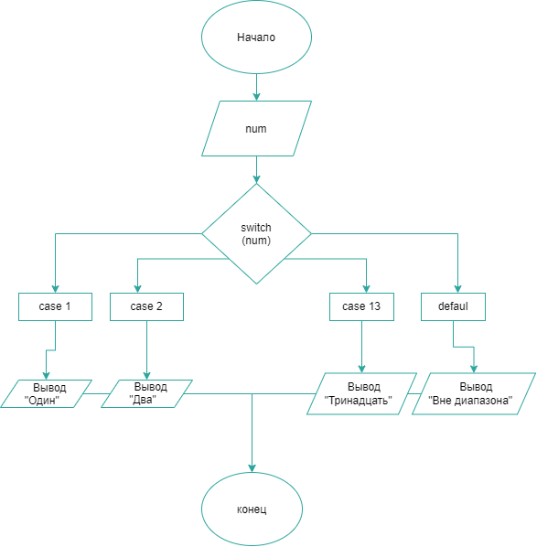

# Домашнее задание к работе 7
Вариант 20

## Условие задачи

Напишие программу перевода чисел от 1 до 13 в слова(без `if-else`)

## 1. Алгоритм и блок-схема

### Алгоритм

1. Начало
2. Объявить переменную `num` целого типа для хранения числа от пользователя.
3. Вывести сообщение к вводу числа от 1 до 13.
4. Считать значение в переменную `num`.
5. С помощью многоальтернативного выбора (оператор `switch`) сопоставить число с его текстовым видом на русском язывке:
   - 1 -> "Один"
   - 2 -> "Два"
   - ...
   - 13 -> "Тринадцать"
6. Если введено число вне диапазона от 1 до 13, то сообщение об несоответсвии диапазону
7. Вывести результат на экран.
8. Конец

### Блок-схема



## 2. Реализация программы


## 3. Результаты работы программы

```
Введи число от 1 до 13: 6
Шесть
```

## 4. Информация о разработчике

- **ФИО:** Лавлинский Алексей Евгеньевич
- **Группа:** бОТИ-261, 2п/г
